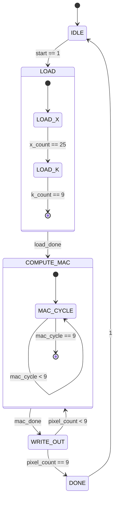
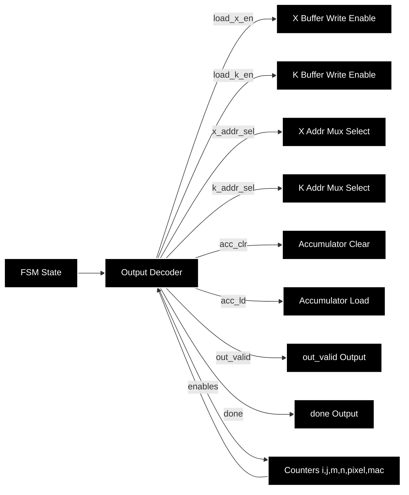

# FSMD Diagrams for Sequential Convolution Engine

## Color Legend (Consistent Across All Diagrams)

| Color | Meaning |
|-------|---------|
| `#1f77b4` / `#d6eaff` | Control Unit / FSM / State Logic |
| `#ff7f0e` / `#ffe0b2` | Input / Output Interfaces |
| `#2ca02c` / `#c8e6c9` | Memory / Register Files / Buffers |
| `#d62728` / `#ffcdd2` | Arithmetic / MAC Unit / ALU |
| `#9467bd` / `#e1bee7` | Address Generation / Index Counters |
| `#8c564b` / `#d7ccc8` | Multiplexers / Data Routing |
| `#e377c2` / `#f8bbd0` | Registers / Storage Elements (pink) |

---

## 1. ASM Chart / FSM State Diagram

### State Descriptions

| State | Description | Exit Condition |
|-------|-------------|----------------|
| **IDLE** | Wait for `start` pulse | `start == 1` |
| **LOAD** | Load 25 X elements + 9 K elements via `in_valid` | `x_count==25 && k_count==9` |
| **COMPUTE_MAC** | 9 sequential MAC cycles per output pixel | `mac_cycle == 9` |
| **WRITE_OUT** | Assert `out_valid` + `data_Y` for 1 cycle | Always (1 cycle) |
| **DONE** | Assert `done`, wait for next `start` | `start == 1` (next frame) |

### Internal Counters

| State | Counters | Description |
|-------|----------|-------------|
| **LOAD** | `x_count[4:0]` (0-24), `k_count[3:0]` (0-8) | X and K element counters |
| **COMPUTE_MAC** | `mac_cycle[3:0]` (0-8), `m[1:0]`, `n[1:0]` | 9 MAC cycles, kernel indices |
| **WRITE_OUT** | `pixel_count[3:0]` (0-8), `i[1:0]`, `j[1:0]` | Output pixel counter, indices |

---

## 2. Datapath Block Diagram (Register Level)

```mermaid
flowchart TB
    subgraph CLK_RST["Clock & Reset"]
        clk["clk"]
        rst_n["rst_n"]
    end

    subgraph INPUTS["Input Interface"]
        sig_start["start"]
        sig_in_valid["in_valid"]
        sig_data_X["data_X[7:0]"]   
        sig_data_K["data_K[7:0]"]
    end

    subgraph CTRL["Control Unit (FSM)"]
        state_reg["state[2:0]"]
        next_state["Next State Logic"]
        x_count["x_count[4:0]"]
        k_count["k_count[3:0]"]
        mac_cycle["mac_cycle[3:0]"]
        pixel_count["pixel_count[3:0]"]
        i_reg["i[1:0]"]
        j_reg["j[1:0]"]
        m_reg["m[1:0]"]
        n_reg["n[1:0]"]
        ctrl_load_x["load_x_en"]
        ctrl_load_k["load_k_en"]
        ctrl_acc_clr["acc_clr"]
        ctrl_acc_ld["acc_ld"]
        ctrl_out_valid["out_valid"]
        ctrl_done["done"]
    end

    subgraph DP["Datapath"]
        subgraph XBUF["X Register File"]
            x_regs["25x 8-bit Unsigned Registers<br/>(X[0] .. X[24])"]:::reg
        end
        
        subgraph KBUF["K Register File"]
            k_regs["9x 8-bit Signed Registers<br/>(K[0] .. K[8])"]:::reg
        end
        
        subgraph ADDR["Address Generation Logic"]
            x_addr_mux["X Address Logic: 5*(i+m)+(j+n)"]:::addr
            k_addr_mux["K Address Logic: 3*m+n"]:::addr
        end
        
        subgraph OMUX["Operand Multiplexers"]
            x_mux["X Mux 25:1 to 8u"]:::mux
            k_mux["K Mux 9:1 to 8s"]:::mux
        end
        
        subgraph MAC["MAC Unit (1x Sequential)"]
            mult["Multiplier 8u x 8s to 16s"]:::alu
            adder["Adder 20s + 16s to 20s"]:::alu
            acc_reg["Accumulator 20-bit signed"]:::reg
        end
        
        subgraph OUTREG["Output Register"]
            y_reg["data_Y[19:0]"]:::reg
        end
    end

    subgraph OUTPUTS["Output Interface"]
        out_valid_o["out_valid"]
        data_Y_o["data_Y[19:0]"]
        done_o["done"]
    end

    %% Clock and Reset Distribution
    clk --> CTRL
    clk --> x_regs
    clk --> k_regs
    clk --> acc_reg
    clk --> y_reg
    
    rst_n --> CTRL
    rst_n --> x_regs
    rst_n --> k_regs
    rst_n --> acc_reg
    rst_n --> y_reg

    %% Input Connections
    sig_start --> CTRL
    sig_in_valid --> CTRL
    sig_data_X --> x_regs
    sig_data_K --> k_regs

    %% Control Unit to Datapath Signals
    ctrl_load_x -.->|load_x_en| x_regs
    ctrl_load_k -.->|load_k_en| k_regs
    x_count -.->|write index| x_regs
    k_count -.->|write index| k_regs

    i_reg -.->|i| x_addr_mux
    j_reg -.->|j| x_addr_mux
    m_reg -.->|m| x_addr_mux
    n_reg -.->|n| x_addr_mux
    
    m_reg -.->|m| k_addr_mux
    n_reg -.->|n| k_addr_mux

    ctrl_acc_clr -.->|acc_clr| acc_reg
    ctrl_acc_ld -.->|acc_ld| acc_reg

    %% Address Generation to Operand Mux Selects
    x_addr_mux -->|"x_addr[4:0]"| x_mux
    k_addr_mux -->|"k_addr[3:0]"| k_mux

    %% Datapath Data Flow
    x_regs -->|25x8u| x_mux
    k_regs -->|9x8s| k_mux

    x_mux -->|8u| mult
    k_mux -->|8s| mult

    mult -->|16s product| adder
    acc_reg -->|20s acc feedback| adder
    adder -->|20s sum| acc_reg

    acc_reg -->|20s result| y_reg

    %% Output Interface Connections
    ctrl_out_valid -.->|enable| y_reg
    ctrl_out_valid -.-> out_valid_o
    y_reg --> data_Y_o
    ctrl_done -.-> done_o

    classDef ctrl fill:#000000,stroke:#ffffff,stroke-width:2px,color:#ffffff;
    classDef io fill:#000000,stroke:#ffffff,stroke-width:2px,color:#ffffff;
    classDef mem fill:#000000,stroke:#ffffff,stroke-width:2px,color:#ffffff;
    classDef alu fill:#000000,stroke:#ffffff,stroke-width:2px,color:#ffffff;
    classDef addr fill:#000000,stroke:#ffffff,stroke-width:2px,color:#ffffff;
    classDef mux fill:#000000,stroke:#ffffff,stroke-width:2px,color:#ffffff;
    classDef reg fill:#000000,stroke:#ffffff,stroke-width:2px,color:#ffffff;
    
    class CLK_RST,CTRL ctrl;
    class INPUTS,OUTPUTS io;
    class XBUF,KBUF mem;
    class MAC alu;
    class ADDR addr;
    class OMUX mux;
    class x_regs,k_regs,acc_reg,y_reg reg;
```

### Datapath Component Summary

| Component | Specification |
|-----------|---------------|
| **X Buffer** | 25 x 8-bit unsigned registers, loaded sequentially in LOAD state |
| **K Buffer** | 9 x 8-bit signed registers, loaded after X in LOAD state |
| **X Address Mux** | Selects `X[i+m, j+n]` using `i,j,m,n` counters (25:1) |
| **K Address Mux** | Selects `K[m,n]` using `m,n` counters (9:1) |
| **Multiplier** | 8-bit unsigned x 8-bit signed to 16-bit signed product |
| **Adder** | 20-bit signed accumulator + 16-bit product to 20-bit signed |
| **Accumulator** | 20-bit signed register with clear/load control |
| **Output Register** | Captures accumulator on `WRITE_OUT` state |
| **Index Counters** | `i,j,m,n` (2-bit each), `pixel_count` (4-bit), `mac_cycle` (4-bit) |

---

## 3. Control Unit to Datapath Signal Mapping

---

## Cross-Reference Verification Matrix

| Signal / Component | FSM Diagram | Datapath Diagram | Ctrl-DP Mapping | Status |
|--------------------|-------------|------------------|-----------------|--------|
| `state[2:0]` | ✓ IDLE/LOAD/COMPUTE/WRITE/DONE | ✓ In CTRL subgraph | ✓ FSM State | ✓ |
| `start` | ✓ IDLE→LOAD trigger | ✓ sig_start→CTRL | — | ✓ |
| `in_valid` | ✓ LOAD data qualifier | ✓ sig_in_valid→CTRL | — | ✓ |
| `load_x_en` | ✓ LOAD_X substate | ✓ ctrl_load_x→XBUF | ✓ DECODER→XBUF | ✓ |
| `load_k_en` | ✓ LOAD_K substate | ✓ ctrl_load_k→KBUF | ✓ DECODER→KBUF | ✓ |
| `x_count[4:0]` | ✓ LOAD counter | ✓ x_count in CTRL | — | ✓ |
| `k_count[3:0]` | ✓ LOAD counter | ✓ k_count in CTRL | — | ✓ |
| `i,j,m,n[1:0]` | ✓ COMPUTE/WRITE counters | ✓ i_reg,j_reg,m_reg,n_reg | ✓ CNT→DECODER | ✓ |
| `mac_cycle[3:0]` | ✓ MAC_CYCLE 0-8 | ✓ mac_cycle in CTRL | — | ✓ |
| `pixel_count[3:0]` | ✓ WRITE_OUT 0-8 | ✓ pixel_count in CTRL | — | ✓ |
| `acc_clr/acc_ld` | ✓ COMPUTE_MAC control | ✓ ctrl_acc_clr/ld→acc_reg | ✓ DECODER→ACC | ✓ |
| `out_valid` | ✓ WRITE_OUT pulse | ✓ ctrl_out_valid→out_valid_o | ✓ DECODER→OUTV | ✓ |
| `data_Y[19:0]` | ✓ WRITE_OUT output | ✓ y_reg→data_Y_o | — | ✓ |
| `done` | ✓ DONE state | ✓ ctrl_done→done_o | ✓ DECODER→DONE | ✓ |
| X Buffer 25x8u | — | ✓ XBUF subgraph | — | ✓ |
| K Buffer 9x8s | — | ✓ KBUF subgraph | — | ✓ |
| Multiplier 8u×8s | — | ✓ mult in MAC | — | ✓ |
| Accumulator 20s | — | ✓ acc_reg in MAC | ✓ ACC_CLR/ACC_LD | ✓ |

---

## Verification Checklist

- [ ] All 5 states present: IDLE, LOAD, COMPUTE_MAC, WRITE_OUT, DONE
- [ ] LOAD state shows 25 X + 9 K element loading via `in_valid`
- [ ] COMPUTE_MAC shows 9 MAC cycles per pixel (m,n = 0-2)
- [ ] WRITE_OUT asserts `out_valid` for 1 cycle per pixel
- [ ] DONE asserts `done` after 9th pixel
- [ ] Datapath shows 25x8u X buffer, 9x8s K buffer
- [ ] Single multiplier (8u x 8s), single 20s accumulator
- [ ] 4D index counters (i,j,m,n) visible
- [ ] Output registers match PDF pinout (out_valid, data_Y[19:0], done)
- [ ] Color scheme consistent across all three diagrams
- [ ] Signal names match between diagrams (cross-reference table verified)

**To verify**: Copy each Mermaid block into https://mermaid.live and confirm visual match to PDF Section 4.